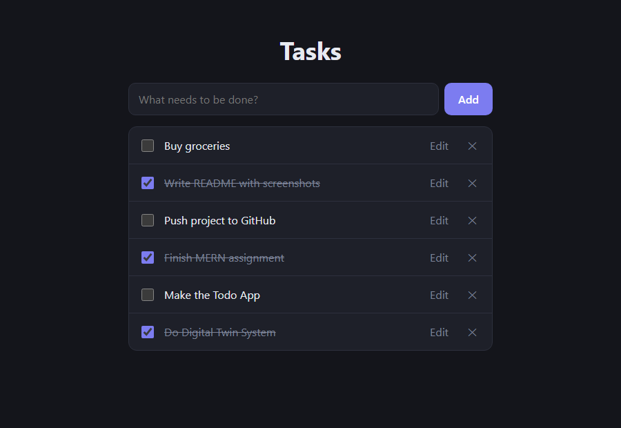

# MERN To-Do List

A full-stack task manager built with MongoDB, Express.js, React (Vite) and Node.js.

## Features

- Add, edit, complete/incomplete and delete tasks
- Tasks are stored in MongoDB and loaded from the API on page load
- Input validation (empty titles are rejected with a 400)
- CORS restricted to the frontend's address

## Project structure

```
backend/    Express + Mongoose REST API
  models/   Task schema
  routes/   /api/tasks endpoints
frontend/   React app
  src/components/   TaskForm, TaskList, TaskItem
```

## API

| Method | Endpoint         | Description                          | Success | Errors   |
| ------ | ---------------- | ------------------------------------ | ------- | -------- |
| GET    | /api/tasks       | Fetch all tasks                      | 200     |          |
| POST   | /api/tasks       | Add a task (`{ title }`)             | 201     | 400      |
| PUT    | /api/tasks/:id   | Update `title` and/or `completed`    | 200     | 400, 404 |
| DELETE | /api/tasks/:id   | Delete a task                        | 200     | 404      |

## Setup

Requires Node.js and a MongoDB database (local or MongoDB Atlas).

### Backend

```
cd backend
npm install
cp .env.example .env
npm run dev
```

Fill in `.env`:

```
PORT=5000
MONGO_URI=<your MongoDB connection string>
FRONTEND_URL=http://localhost:5173
```

### Frontend

```
cd frontend
npm install
cp .env.example .env
npm run dev
```

Fill in `.env`:

```
VITE_API_URL=http://localhost:5000/api/tasks
```

Open http://localhost:5173.

## Screenshots

Tasks can be added, edited, completed (struck through) and deleted, all through the backend API.


